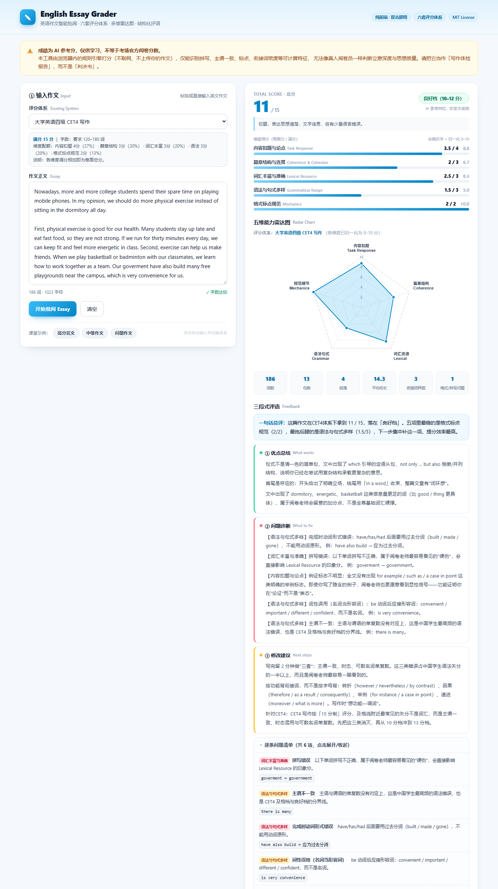
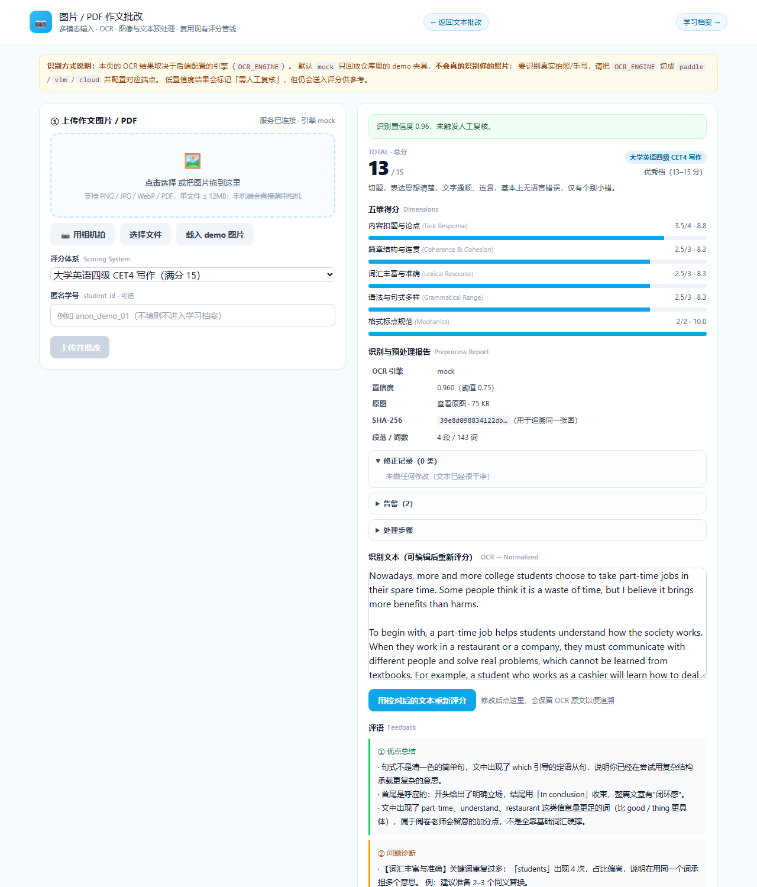
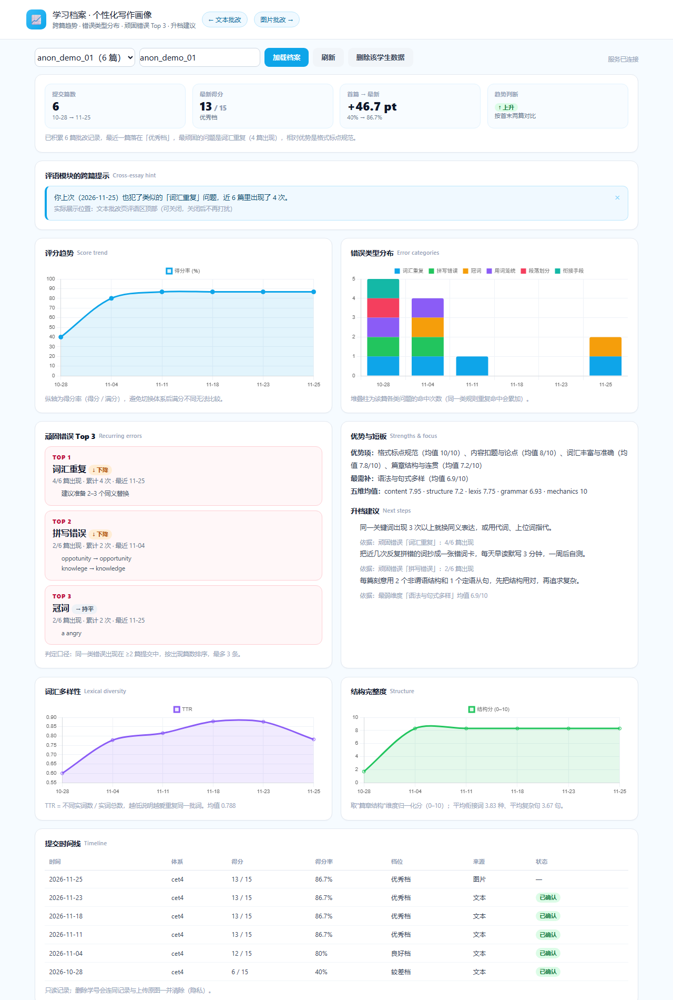

# English Essay Grader · 英语作文智能批阅

> 一个**纯前端**的单页英语作文批阅工具：选评分体系 → 粘贴作文 → 立刻得到「五维雷达图 + 总分档位 + 三段式评语 + 逐条问题清单」。
> 双击 `index.html` 就能用，零安装、零后端、不上传任何文本。
>
> 在此基础上还有两个**增量模块**（启动本地服务后可用，不影响上面的零依赖用法）：
> **A. 多模态输入**（拍照/图片/PDF → OCR → 预处理 → 走同一套评分）与
> **B. 学习分析档案**（同一学生多篇 → 趋势仪表盘、顽固错误 Top 3、可关闭的跨篇提示）。



<p align="left">
  
  
  
  
  
  
</p>

---

## 一、这个项目解决什么问题

写英语作文最痛苦的不是"写不出来"，而是**写完不知道哪里不行**：

- 老师不可能每篇都精批；
- 在线批改工具要么收费，要么要上传作文（隐私顾虑），要么要注册登录；
- 学生看到"12/15 分"这三个数字，仍然不知道下一句该怎么改。

所以这个项目做了三件事：

1. **按考试打分**：内置高考、CET4、CET6、TEM4、雅思 Task 2、托福独立写作六套评分框架，同一篇作文在不同体系下得分不同——这本身就是一个很好的课堂讨论点。
2. **把分数拆开**：不只给总分，还给出五个维度的分数与雷达图，让你看见"是词汇拖后腿，还是结构拖后腿"。
3. **把问题说具体**：评语里会引用你原文的句子、拼错的单词、用错的衔接词，而不是"语言表达有待提高"。

> ⚠️ **重要说明**：本工具给出的是 **AI 参考分**，由浏览器内的规则引擎计算，仅供学习参考，**不能替代官方人工阅卷**。页面顶部有固定的免责提示。

---

## 二、功能特性

| 模块 | 说明 |
| --- | --- |
| 作文输入 | 大文本框，实时显示词数/字符数，并提示离字数要求还差多少 |
| 评分体系 | 六套体系下拉切换，自动加载该体系的维度配额、满分、字数要求、档位描述 |
| 五维打分 | 内容扣题 / 篇章结构 / 词汇资源 / 语法句式 / 规范细节，每项给出「卷面分 + 0–10 归一化分」 |
| 雷达图 | Chart.js 绘制，五轴对应五维，标题标注当前考试体系，另附一条满分参考虚线 |
| 总分档位 | 例如 CET4「11 / 15 · 良好档」、雅思「6.0 · Band 5.5–6 合格」 |
| 三段式评语 | ① 优点总结 ② 问题诊断 ③ 修改建议，全部基于本文实际内容生成 |
| 问题清单 | 逐条列出拼写、语法、标点、结构问题，附原文摘录 |
| 课堂示例 | 一键载入「高分 / 中等 / 问题」三篇样例，自动切换对应体系 |
| 结果导出 | 一键复制评语、导出 `.txt` 报告，方便交作业或留档 |
| 响应式 | 桌面左右分栏，移动端自动堆叠 |
| 🆕 图片/PDF 批改 | 拍照或上传图片/PDF → OCR（引擎可插拔）→ 文本标准化 → 复用同一套评分；附预处理报告与人工复核标记 |
| 🆕 学习档案 | 同一匿名学号的多篇提交 → 评分趋势 / 错误类型堆叠 / 词汇多样性 / 结构完整度 / 顽固错误 Top 3 / 升档建议 |
| 🆕 跨篇提示 | 批阅页评语区顶部显示「你上次也犯了类似的…」，可一键关闭，不填学号则完全不出现 |

---

## 三、快速开始

### 方式 A：直接双击（推荐，课堂演示用这个）

```
下载仓库 → 双击 index.html → 浏览器打开 → 开始用
```

不需要 Node、不需要 Python、不需要 `npm install`，也不需要任何本地服务器。

> 注意：这条只适用于**文本批改页**。顶部的「图片/PDF 批改」「学习档案」两个入口需要后端服务，
> 请按下面的**方式 D** 用 `start.cmd` / `npm start` 启动；否则这两个页面会显示启动指引而不是内容。

### 方式 B：本地起一个静态服务（可选）

```bash
# 如果你习惯用 localhost 访问
python -m http.server 8000
# 然后打开 http://localhost:8000
```

### 方式 C：部署到 GitHub Pages

1. 把仓库推上 GitHub；
2. `Settings → Pages → Source` 选择 `main` 分支、`/ (root)`；
3. 一分钟后访问 `https://<你的用户名>.github.io/<仓库名>/`。

> GitHub Pages 只能托管静态文件，**多模态上传与学习档案需要后端**，因此 Pages 上只有文本批改页可用（新增页面会提示"未连接本地服务"）。

### 方式 D：启动完整服务（图片/PDF 批改、学习档案**必须**走这条）

> **先说清楚一件事：为什么双击那两个 html 用不了？**
> 图片批改要先跑 OCR，学习档案要先读历史记录——这两件事都在后端，纯浏览器做不了。
> 所以这两个页面必须配一个本地服务；但**不需要你懂命令行**：
>
> - **Windows：双击根目录的 `start.cmd`** —— 自动启动服务并打开浏览器；
> - **macOS / Linux：在根目录执行 `./start.sh`**（等价于 `npm start`）。
>
> 页面本身也做了兜底：连不上时会直接显示启动步骤、「立即重试」和自定义服务地址；
> **服务启动后不用刷新，3 秒内会自动连上**（页面每 3 秒探一次 `/api/health`）。

```bash
./start.sh          # macOS / Linux：起服务 + 自动开浏览器
npm start           # 任何平台，效果相同（Node ≥ 20，零第三方依赖）
```

服务起来后：

| 页面 | 地址 |
| --- | --- |
| 文本批改 | <http://127.0.0.1:8787/index.html> |
| 图片/PDF 批改 | <http://127.0.0.1:8787/frontend/src/pages/MultimodalUpload/index.html> |
| 学习档案 | <http://127.0.0.1:8787/frontend/src/pages/LearningProfile/index.html?student=anon_demo_01> |

> 这两个页面也支持直接双击打开：它们会自动去 `127.0.0.1:8787` 找后端，
> 找到就正常用，找不到就显示启动指引 —— 不会白屏，也不会静默失败。

**关于「在 IDE 预览面板里点『← 文本批改』没反应」**

不是链接写错了，是预览面板的渲染方式不同：它把 HTML 塞进 `<iframe srcdoc>`，
文档地址变成 `about:srcdoc`，**相对链接的基准变成了宿主程序的地址**（而不是 HTML 文件所在目录），
所以 `../../../../index.html` 会解析到宿主目录里，点下去自然打不开。

现在三个页面之间的跳转都走了兼容逻辑：已连上本地服务时，用「服务地址 + 仓库内绝对路径」跳转
（例如 `http://127.0.0.1:8787/index.html`）；直接双击打开（`file://`）时仍用相对路径；
两边都不成立时给明确提示，而不是静默失败。所以**面板里也能正常互相跳转了，前提是服务已经起起来**。

**端口被占了？** 换端口启动，然后在页面断线卡片里点「高级：自定义服务地址」填 `http://127.0.0.1:9000`：

```bash
PORT=9000 npm start
```

生成演示数据（同一匿名学生的 5 篇提交）：

```bash
npm run seed
```

配置 OCR 引擎（默认 `mock` 只回放 demo 夹具，不识别真实图像）：

```bash
cp .env.example .env      # 然后按需修改 OCR_ENGINE / PADDLEOCR_ENDPOINT / ...
```

### 环境要求

- 任意现代浏览器（Chrome / Edge / Firefox / Safari）；
- **不需要联网**：Chart.js 4.4.1 已内置在 `assets/vendor/chart.umd.min.js`，断网或校园网拦截 CDN 也能正常出雷达图；
- Tailwind CSS 仍按原方案走 CDN，但只用于顶栏一行的工具类，取不到也不影响布局（关键样式都在页面内联 CSS 里）。

> 课堂演示：直接双击 `start.cmd`（或 `index.html`）即可，不必提前联网预热缓存。
> 只有本地 `assets/vendor/` 缺失时才会回落到 jsdelivr CDN；两者都失败时页面自动降级为「分数条」，不会白屏。

---

## 四、使用教程

1. **选体系**：在「评分体系」下拉框里选本次要模拟的考试。下方灰框会立刻显示该体系的满分、维度配额、字数要求。
2. **贴作文**：把作文粘进文本框。左下角实时显示词数，右侧会显示「还差 8 词」或「✓ 字数达标」。
3. **点批阅**：点击「开始批阅」，约有 1.5 秒的分析动画（依次提示切分句子、统计词频、核对拼写、对照细则、生成评语）。
4. **看结果**：
   - 右上角：总分 + 档位 + 该档位的官方描述；
   - 中间：五维分数条 + 雷达图（灰字为归一化到 0–10 的分数）；
   - 下方：一句话总评 + 三段式评语 + 逐条问题清单。
5. **换体系对比**：结果出来后直接切换下拉框，页面会用新体系**自动重算**——同一篇作文，高考 22/25，CET4 13/15，雅思 8.0，这就是最直观的课堂素材。
6. **导出**：点「复制评语」或「导出报告(.txt)」，把结果带走。

### 课堂演示三步走

| 步骤 | 操作 | 想让学生看到什么 |
| --- | --- | --- |
| 1 | 载入「高分范文」 | 雷达图接近满圆，评语以"优点"为主 |
| 2 | 载入「中等作文」 | 雷达图出现明显凹陷（语法/结构），评语给出可执行建议 |
| 3 | 载入「问题作文」 | 五维塌陷 + 一串具体错误（小写 i、a international、many way） |
| 4 | 把第 2 篇从 CET4 切到 CET6 | 同一篇作文分数下降，说明"评分标准不同，努力方向也不同" |

---

## 五、评分标准说明

### 5.1 五维框架（所有体系共用）

| 维度 | 英文术语 | 关注点 |
| --- | --- | --- |
| 内容扣题与论点 | Task Response | 是否回应题目、立场是否明确、有无例证、字数是否达标 |
| 篇章结构与连贯 | Coherence & Cohesion | 分段是否合理、衔接词种类与密度、首尾是否呼应 |
| 词汇丰富与准确 | Lexical Resource | 词汇多样性、长词/学术词比例、高频词是否过度重复、拼写 |
| 语法与句式多样 | Grammatical Range & Accuracy | 主谓一致、时态、冠词、单复数、从句与非谓语的使用 |
| 格式标点规范 | Mechanics | 句首大写、句末标点、中英标点混用、逗号后空格 |

### 5.2 各体系维度配额对照表

| 评分体系 | 卷面满分 | 内容 | 结构 | 词汇 | 语法 | 规范 | 字数要求 |
| --- | --- | --- | --- | --- | --- | --- | --- |
| 高考英语（全国卷） | 25 | 8 (32%) | 5 (20%) | 5 (20%) | 5 (20%) | 2 (8%) | 100 词左右 |
| CET4 写作 | 15 | 4 (27%) | 3 (20%) | 3 (20%) | 3 (20%) | 2 (13%) | 120–180 词 |
| CET6 写作 | 15 | 4 (27%) | 3 (20%) | 3 (20%) | 3 (20%) | 2 (13%) | 150–200 词 |
| TEM4 写作 | 20 | 6 (30%) | 4 (20%) | 4 (20%) | 4 (20%) | 2 (10%) | 约 200 词 |
| IELTS Task 2 | 9（四项平均） | 9 (25%) | 9 (25%) | 9 (25%) | 9 (25%) | 9（辅助） | ≥ 250 词 |
| TOEFL 独立写作 | 30 | 9 (30%) | 7 (23%) | 6 (20%) | 6 (20%) | 2 (7%) | 300 词以上 |

> 雅思按官方四项标准（TR / CC / LR / GRA）取平均，Mechanics 只作为辅助观察维度显示在雷达图上，**不计入总分**——因为雅思官方评分标准里没有独立的 mechanics 一项。

### 5.3 档位对照表

**高考（25 分）**

| 分数区间 | 档位 | 官方描述要点 |
| --- | --- | --- |
| 21–25 | 第五档 优秀 | 覆盖全部要点，语法词汇较丰富，错误多为尝试复杂结构所致，衔接有效、结构紧凑 |
| 16–20 | 第四档 良好 | 漏 1–2 个次要点，语言基本准确，有基本衔接 |
| 11–15 | 第三档 一般 | 遗漏部分要点，错误不影响整体理解，结构基本完整 |
| 6–10 | 第二档 较差 | 遗漏主要要点，语法单调、词汇有限，缺少衔接 |
| 1–5 | 第一档 差 | 内容太少或完全跑题，难以理解 |
| 0 | 0 分 | 白卷 / 完全无关 |

**CET4 / CET6（15 分）**

| 分数区间 | 档位 | 官方描述要点 |
| --- | --- | --- |
| 13–15 | 优秀 | 切题，思想清楚，文字通顺连贯，基本无语言错误，仅个别小错 |
| 10–12 | 良好 | 切题，表达清楚，文字连贯，有少量语言错误 |
| 7–9 | 及格 | 基本切题，部分表达不清，文字勉强连贯，错误相当多 |
| 4–6 | 较差 | 表达不清，连贯性差，较多严重错误 |
| 1–3 | 差 | 条理不清，语言支离破碎，多数句子有错误 |

> 六级的文字描述与四级相同，但阅卷对语言质量的实际容忍度更低。本项目用 `strictness: 0.88`（四级 1.00）模拟这一差异，所以同一篇作文在六级体系下通常比四级低 2 分左右。

**TEM4（20 分）**

| 分数区间 | 档位 |
| --- | --- |
| 18–20 | 优秀（论点充分、论证有力、几乎无错） |
| 15–17 | 良好（切题、结构完整、有少量错误） |
| 12–14 | 中等（论点尚清楚但论证偏薄、错误不影响理解） |
| 9–11 | 及格（部分切题、结构松散、句式单一） |
| 5–8 | 较差（偏题或论证混乱、错误密集） |

**IELTS Task 2（0–9）**

| 分数区间 | 档位 | 关键描述 |
| --- | --- | --- |
| 8.5–9 | Expert 专家级 | 完全回应任务，衔接自然，词汇精准，语法几乎全对 |
| 7.5–8 | Very Good 很好 | 立场清晰、展开充分，偶有语言 slips |
| 6.5–7 | Good 良好 | 回应要点，观点展开不足，衔接略机械 |
| 5.5–6 | Competent 合格 | 部分内容不相关，词汇有限，错误明显但不妨碍理解 |
| 4.5–5 | Modest 基础 | 仅部分回应任务，组织零散，错误频繁 |
| 3.5–4 | Limited 有限 | 任务回应不足，句子难以理解 |

**TOEFL 独立写作（0–30）**

| 分数区间 | 档位 |
| --- | --- |
| 27–30 | Advanced 高级（论证充分、细节具体、语言多样准确） |
| 24–26 | Good 良好（论证较充分，偶有错误） |
| 20–23 | Fair 中等（论证不充分、例子笼统、过渡生硬） |
| 15–19 | Limited 有限（回应不完整、结构松散） |
| 8–14 | Basic 基础（组织混乱、错误密集） |

### 5.4 打分是怎么算出来的（可解释、可复现）

所有分数来自**浏览器本地**的文本分析，不调用任何在线模型：

```
作文文本
  ├─ 分句 / 分词 / 分段
  ├─ 指标计算：词数、句数、平均句长、句长标准差、类符形符比(TTR)、长词比例、衔接词种类、复杂句标志数
  ├─ 规则诊断：拼写(120+错词表)、主谓一致、冠词、单复数、完成时、词性误用、中式双连词、
  │            句子片段、run-on、逗号拼接、大小写、标点、中英标点混用……
  ↓
五个维度各自算 0~1 的"达成率"（加权求和）
  ↓
维度得分 = 达成率 × 该维度满分（四舍五入到 0.5）
总分   = 各维度相加（雅思取四项平均）
  ↓
查档位表 → 生成评语
```

几个设计上的取舍，值得在课上讲：

- **字数不足是硬扣分**：内容分随字数按曲线衰减（`0.9 × (实际/要求)^1.6`），因为真实考试里字数不够会直接压档。
- **交叉影响**：当语法+词汇的达成率低于 0.7 时，内容与结构分也会被打折——满篇语法错误时，阅卷老师根本没耐心找你的论点。
- **不给满分**：即使全项达标，单维度最高只给「满分 − 0.5」，避免出现"AI 打满分"的失真结果。
- **结果稳定**：同一条文本、同一体系，多次批阅结果完全一致（抖动因子由文本哈希决定），课堂演示不会"刷新一次变一个分"。

---

## 六、模块 A：多模态输入与预处理（新增）

> 拍照/扫描的作文，不用先手打一遍。上传图片或 PDF → OCR → 文本标准化 → **交给现有评分管线** → 返回原来的批改结果 + 一份预处理报告。



<sub>▲ 实际本地渲染截图（`?submission=` 直接打开某次识别结果）。图中数据来自 `sample_data` 的 demo 图片，不是伪造的示意图。</sub>

### 6.1 链路

```
图片/PDF ──▶ OCR 引擎（可插拔）──▶ 文本级预处理 ──▶ scoring-adapter ──▶ 既有评分引擎
                                        │                                   │
                                        └──▶ preprocess_report              └──▶ grading（与文本批改同构）
```

- 图像级处理（方向矫正、去噪、二值化）由 OCR 引擎负责，报告里原样透传引擎自报结果；
- 文本级标准化由本模块实现：全角标点 → 半角、弯引号 → 直引号、跨行断词合并、页码/页眉清理、空格规范化、段落还原（空行 / 缩进 / 句末标点三种信号）；
- **拼写只标记不改写**：如果把学生的拼错自动改对，评分引擎就再也发现不了这些错误了。所以拼写问题写进 `preprocess_report.spelling_flags` 供人工核对，正文一个字不动。

### 6.2 怎么用

```bash
npm start                 # 启动服务（默认 http://127.0.0.1:8787）
# 打开 http://127.0.0.1:8787/frontend/src/pages/MultimodalUpload/index.html
```

页面支持：拍照（`capture`）/ 拖拽 / 选择文件、上传进度条、识别结果**可编辑**后重新评分、原图回看。

### 6.3 OCR 引擎（通过环境变量切换，不硬编码）

| `OCR_ENGINE` | 说明 | 需要的变量 |
| --- | --- | --- |
| `mock`（默认） | **只回放 `sample_data/ocr_fixtures` 里的 demo 夹具，不识别真实图像** | 无 |
| `paddle` | 自建 PaddleOCR HTTP 服务 | `PADDLEOCR_ENDPOINT` / `PADDLEOCR_API_KEY` |
| `vlm` | 视觉大模型整页转录（OpenAI 兼容 `/chat/completions`） | `VLM_ENDPOINT` / `VLM_MODEL` / `VLM_API_KEY` |
| `cloud` | 云厂商 OCR（通用 HTTP 契约） | `CLOUD_OCR_ENDPOINT` / `CLOUD_OCR_KEY` |

> ⚠️ **默认 `mock` 不会真的识别你的照片**。这是刻意的：仓库里不放真实学生图片，也不伪造识别结果。
> 要识别真实手写/拍照，请按 `.env.example` 配置 `paddle` / `vlm` / `cloud` 之一。
> 引擎未配置时接口返回 `503 OCR_ENGINE_UNAVAILABLE` 并说明缺哪个变量，而不是静默返回空文本。

### 6.4 人工复核（needs_review）

| 触发条件 | 结果 |
| --- | --- |
| 置信度 < `OCR_CONFIDENCE_THRESHOLD`（默认 0.75） | `needs_review: true`，**仍然送入评分** |
| 引擎不返回置信度（如 VLM） | `needs_review: true`，`confidence: null`（不编造数字） |
| 标准化后 < 30 词 / 没有句末标点 | 追加对应 `review_reasons` |
| 标准化后 < 5 词 | 直接 `422 TEXT_TOO_SHORT`，不落库、不留原图 |

### 6.5 接口

详见 [`docs/api/multimodal.md`](docs/api/multimodal.md)：`POST /api/multimodal/upload`、`GET /api/multimodal/submissions/{id}`、`POST /api/multimodal/submissions/{id}/confirm`、`GET /api/multimodal/engines`、`GET /api/multimodal/exams`。

---

## 七、模块 B：学习分析与个性化写作档案（新增）

> 单篇批改告诉你"这篇哪里不行"，跨篇分析告诉你"你一直在哪里不行"。



<sub>▲ 实际本地渲染截图。数据来自 `npm run seed` 生成的 5 篇 demo 提交（同一匿名学号），分数由评分引擎实时算出，**未预置任何分数**。</sub>

### 7.1 能看到什么

| 区块 | 内容 |
| --- | --- |
| 趋势折线 | 得分率（得分/满分，跨体系可比）随时间变化，附首末差值与 `up/down/flat` 判断 |
| 错误类型堆叠柱 | 每篇各类问题的命中次数，颜色区分 22 个规范化错误类别 |
| 顽固错误 Top 3 | 出现 ≥2 篇的错误类别，按「出现篇数 → 严重度 → 累计次数」排序，标注上升/下降趋势 |
| 优势与短板 | 五维均值排序，找出最强项与最弱项 |
| 升档建议 | 由顽固错误 + 最弱维度生成的可执行练习建议（不是"多读多写"这种空话） |
| 时间线 | 倒序列出每次提交：体系、得分、档位、来源（文本/图片）、是否待复核 |

### 7.2 与评语模块的联动（可关闭）

批阅页在填了匿名学号后会自动把这次结果存进档案，并在评语区顶部显示一条**可关闭**的提示：

> 📌 **历史提醒** 你上次（2026-11-25）也犯了类似的「词汇重复」问题，近 6 篇里出现了 4 次。

- 只有**当前这篇确实复现了**历史顽固错误，才会说"也犯了"（`mode: recur`）；
- 若本篇没复现，改成提醒口吻：`近 5 篇里「拼写错误」出现了 3 次，交卷前建议专门检查一遍`（`mode: watch`）——不谎称"这篇也错了"；
- 关闭后写入 `localStorage`，不再打扰；左侧有「重新开启跨篇提示」；
- **不填学号 = 完全离线**，页面行为与改造前完全一致。

### 7.3 看一眼效果

```bash
npm start                      # 终端 1
npm run seed                   # 终端 2：生成 anon_demo_01 的 5 篇 demo 提交
# 打开 http://127.0.0.1:8787/frontend/src/pages/LearningProfile/index.html?student=anon_demo_01
```

seed 数据（`sample_data/essays.json`）是**本项目自己写的 5 篇 CET4 作文**，质量由低到高递进，用于演示趋势：
40% → 73% → 87% → 87% → 87%，趋势判为 `up`；顽固错误 Top 3 = 词汇重复 / 拼写错误 / 用词笼统。

### 7.4 隐私

- 只接受**匿名学号**（`^[A-Za-z0-9_-]{3,64}$`），邮箱/手机号/中文姓名在入口就被拒绝；
- 不采集姓名、班级、IP；
- `DELETE /api/analytics/students/{id}` 会连同上传的原图一起删除。

### 7.5 接口

详见 [`docs/api/analytics.md`](docs/api/analytics.md)：`/dashboard`、`/profile`、`/timeline`、`/records`、`DELETE /students/{id}`。
无历史数据时统一返回 `200` + `"暂无历史数据"`，不报错。

---

## 八、代码结构

全部批改逻辑都在 `index.html` 里，按 10 个模块分块，文件内有中文注释，方便逐段讲：

| 模块 | 位置 | 作用 |
| --- | --- | --- |
| 1. 考试体系配置 | `EXAM_SYSTEMS` | 六套体系的维度满分、档位表、字数要求、备考建议 |
| 2. 词库 | `TRANSITIONS` / `MISSPELL` / `CLICHES` / `SYNONYMS` | 衔接词、错词表、模板化短语、同义替换 |
| 3. 文本工具 | `splitSentences()` 等 | 分句、分词、分段、哈希 |
| 4. 诊断规则 | `diagnose()` | 20+ 条规则，输出带原文摘录的 finding 列表 |
| 5. 打分引擎 | `computeScores()` | 指标 → 五维达成率 → 卷面分 → 总分 → 档位 |
| 6. 评语生成 | `buildComment()` | 优点/问题/建议三段，引用具体内容 |
| 7. 主流程 | `analyzeEssay()` | 串起统计、诊断、打分、评语 |
| 8. 界面渲染 | `renderResult()` / `renderRadar()` | 分数面板、Chart.js 雷达图、评语卡片 |
| 9. 演示样例 | `SAMPLES` | 高分/中等/问题三篇，一键载入 |
| 10. 事件绑定 | `DOMContentLoaded` | 按钮、下拉框、导出、复制 |

想改评分口味？只改 `EXAM_SYSTEMS` 里的数字即可，比如把 CET4 的内容权重调高，其它代码不用动。

### 8.1 后端：为什么评分逻辑没有第二份

后端**没有**把评分公式搬过来，而是在 Node 的 `vm` 沙箱里**加载并执行 `index.html` 的内联脚本**，直接调用里面的 `analyzeEssay()`：

```
backend/app/adapters/scoring-adapter.js
  ├─ 读 index.html → 取出内联 <script>
  ├─ vm.createContext({ document: stub, Chart: stub, ... })
  ├─ vm.runInContext(script + 导出 shim)
  └─ 拿到 { analyzeEssay, EXAM_SYSTEMS, DIM_ORDER, SAMPLES }
```

好处：改 `index.html` 的任何系数，后端结果立刻跟着变，不存在"前端 13 分、后端 11 分"的漂移。
代价：首次加载有几十毫秒开销（已按 mtime 缓存），且引擎脚本不能在顶层依赖真实 DOM。

### 8.2 测试与质量

```bash
npm test              # 全部测试（Node 内置 test runner，零依赖）
npm run test:multimodal
npm run test:analytics
npm run lint          # 语法检查（含 HTML 内联脚本）+ 密钥扫描
```

> 测试入口是 `scripts/run-tests.mjs`：它自己递归收集测试文件再交给 `node --test`。
> 原因很实际——`node --test` 对位置参数的解释在 Node 20 与 22 上相反（20 传 glob 不展开、22 传目录当模块），
> 写死 `"tests/**/*.test.js"` 或 `tests` 都只能在一个版本上跑通。CI 用 Node 20 / 22 双矩阵，所以必须绕开这个差异。

| 测试文件 | 覆盖 |
| --- | --- |
| `tests/multimodal/preprocess.test.js` | 标点/断词/段落还原/低置信度/不改写原意（13 例） |
| `tests/multimodal/ocr-engine.test.js` | 夹具与图片 sha256 一致、未知文件不编造、引擎注册表（7 例） |
| `tests/multimodal/api.test.js` | 上传→评分、原图回取、人工确认、422/415/400/404、旧端点不变（9 例） |
| `tests/analytics/aggregate.test.js` | 空态/单篇/趋势/Top3/hint 两种口径/旧数据兼容（13 例） |
| `tests/analytics/api.test.js` | 5 篇入库→仪表盘/档案/时间线、幂等、隐私删除（11 例） |
| `tests/pages/navigation.test.js` | 三页跨页入口都带 `data-page`、路由路径真实存在、srcdoc 兼容逻辑仍在（3 例） |

合计 **56 个测试**（`npm test` 一次跑完，约 1 秒）。

CI（`.github/workflows/ci.yml`）在 Node 20 / 22 上跑 `npm run lint` + `npm test`，不需要装任何依赖。

> 测试里的期望值来自**实际运行结果**，不是手写的理想值；demo 数据的分数没有预置在任何文件里。

---

## 九、局限说明（请务必读）

1. **它不懂"立意"**。规则引擎能数出你有几个衔接词、几处主谓不一致，但判断不了你的论点是否深刻、例子是否恰当。思想层面的评价必须靠人。
2. **拼写检查依赖内置词表**（约 120 个高频错词），不覆盖全部错误；不在词表里的拼写错误会漏掉。
3. **语法检查是模式匹配**，会有漏报和误报。它抓的是"中国学生高频错误模式"，不是完整语法分析器。
4. **分数是参考值，不是考场分数**。同一篇作文在不同阅卷员手里可能差 1–2 分，本工具只能给一个"大致坐标"。
5. **非英语文本、诗歌、剧本、图表作文**不在支持范围内（雅思 Task 1、托福综合写作均未覆盖）。
6. **雷达图已内置，不依赖联网**；仅 Tailwind CDN 仍需网络，但它只影响顶栏一行工具类，缺失时布局不变。
7. **文本批改页不存储任何文本**：不填学号、不启动服务时，刷新即清空，作文不出浏览器。
   一旦填了匿名学号并连上本地服务，记录会写进 `backend/data/db.json`（本地文件，已在 `.gitignore` 中）。
8. **默认 OCR 引擎 `mock` 不识别真实图片**：它只回放 `sample_data/ocr_fixtures` 里的 demo 夹具。
   这不是 bug，而是刻意避免在仓库里放真实学生图片、也避免伪造识别结果。要识别真实拍照/手写，
   必须配置 `paddle` / `vlm` / `cloud`（见 `.env.example`）。未配置时接口会返回 `503` 并说明缺哪个变量。
9. **图像级预处理依赖 OCR 引擎**：方向矫正、去噪、二值化属于像素操作，本项目不做，报告里原样透传引擎自报结果。
   文本级标准化（标点、空格、断行、断词、段落还原）才是本项目实现的。
10. **单一进程 + JSON 文件存储**：适合课堂与课程作业（几十到几百条）。多实例部署请换 PostgreSQL，
    迁移脚本的语义（add column / backfill / index）可以一对一平移。
11. **跨篇提示只覆盖"可量化的错误"**：它来自 22 个错误类别，不懂"立意"和"论证深度"，
    所以它只能提醒你"拼写又错了"，不能提醒你"这次还是没想清楚"。

---

## 十、目录结构

```
english-essay-grader/
├── index.html                       # 文本批改页（单文件，双击即用；也是唯一的评分实现）
├── README.md                        # 本文档
├── LICENSE                          # MIT 协议
├── start.cmd                        # Windows 一键启动：起服务 + 开浏览器（双击即可）
├── start.sh                         # macOS / Linux 一键启动
├── package.json                     # 脚本：start / test / lint / seed（无第三方依赖）
├── .env.example                     # 环境变量示例（不含任何密钥）
├── backend/
│   ├── server.js                    # HTTP 入口（Node 内置 http，零依赖）
│   └── app/
│       ├── config.js                # 环境变量集中读取
│       ├── errors.js                # 统一错误码
│       ├── http/                    # router / respond / multipart / static
│       ├── adapters/
│       │   ├── scoring-adapter.js    # ★ 在 vm 里加载 index.html 的引擎（零复制复用）
│       │   └── record-adapter.js     # findings → 结构化错误类别
│       ├── store/
│       │   ├── db.js                # 单文件 JSON 存储 + 串行写队列
│       │   └── migrations.js        # v1 → v2 → v3 幂等迁移
│       └── modules/
│           ├── multimodal/          # 模块 A：上传 / OCR / 预处理
│           │   ├── routes.js  service.js  preprocess.js  storage.js
│           │   └── ocr/             # mock / paddle / vlm / cloud 四引擎
│           └── analytics/           # 模块 B：聚合与档案
│               ├── routes.js  service.js  aggregate.js  advice.js
├── frontend/src/pages/
│   ├── MultimodalUpload/index.html   # 图片/PDF 上传页
│   └── LearningProfile/index.html    # 学习档案页
├── tests/
│   ├── multimodal/                  # 预处理单测 / 引擎单测 / 上传集成测试
│   └── analytics/                   # 聚合单测 / 接口集成测试
├── sample_data/
│   ├── essays.json                  # 5 篇 demo 作文（同一学生的递进序列）
│   ├── seed-analytics.js            # seed 脚本
│   ├── images/                      # 两张 demo 图片（由脚本从 txt 渲染，非真实扫描件）
│   └── ocr_fixtures/                # mock 引擎的夹具与说明
├── scripts/
│   ├── lint.js                      # 零依赖 lint（语法 + 内联脚本 + 密钥扫描）
│   └── make-sample-images.mjs       # 重新生成 demo 图片并回填 sha256
├── assets/                          # 截图 + 内置的 Chart.js
│   └── vendor/chart.umd.min.js      # Chart.js 4.4.1（本地副本，断网也能画雷达图）
└── docs/
    ├── architecture.md              # 模块关系图 / 数据流图 / 数据模型 / 迁移
    ├── api/multimodal.md            # 多模态 API 文档
    ├── api/analytics.md             # 学习分析 API 文档
    ├── 课堂演讲稿.md                 # 3–5 分钟上台讲稿
    ├── PPT汇报大纲.md                # 汇报 PPT 的 12 页大纲
    └── 演示测试样例.md               # 高分 / 中等 / 待改进 三篇样例
```

---

## 十一、未来可以做的事

- [ ] 接入真实大模型 API（可选的"深度点评"开关），与本地规则分形成对照；
- [ ] 增加雅思 Task 1、托福综合写作的评分框架；
- [ ] 支持"逐句批注"：把错误直接标在原文上（contenteditable + 高亮）；
- [x] ~~本地历史记录，看同一学生的进步曲线~~ → 已由「学习分析与写作档案」模块实现（后端 JSON 存储，非 localStorage）；
- [ ] 中英双语界面切换，方便英语课与双语课使用；
- [ ] 导出 PDF 批改报告（含雷达图）；
- [ ] 多模态：PDF 逐页栅格化与版面分析（当前 PDF 依赖 OCR 引擎自行处理）；
- [ ] 学习档案：按班级聚合（教师视角），支持导出班级薄弱项统计；
- [ ] 存储：把 JSON 文件存储换成 PostgreSQL，迁移脚本语义已对齐，可平移；
- [ ] 分析：把"错误类别趋势"做成预测（预判下一篇最可能复发的两类错误）。

---

## 十二、开源协议

本项目基于 [MIT License](LICENSE) 开源，可自由用于学习、教学、课程作业与二次开发，保留版权声明即可。

如果这个项目对你的课堂或作业有帮助，欢迎点个 ⭐。
