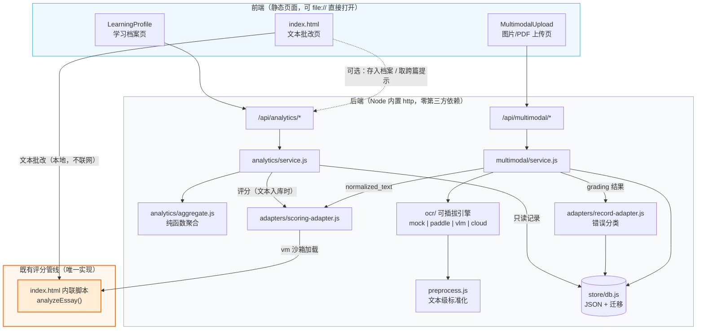
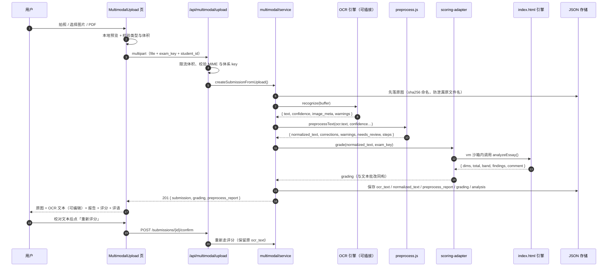
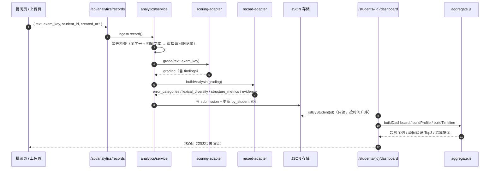

# 架构说明 · Architecture

> 本文档描述 **原有四模块** 与 **新增两模块** 的关系、数据流、集成点、数据模型与迁移策略。
> 一句话概括：新增的两个模块只负责「拿到文本」和「聚合历史」，**打分永远只有一处实现**（`index.html` 里的 `analyzeEssay`）。

---

## 1. 六个模块总览

| # | 模块 | 状态 | 入口 | 职责 |
| --- | --- | --- | --- | --- |
| 1 | 评分 Engine | 既有 | `index.html` → `analyzeEssay()` | 五维打分、总分、档位 |
| 2 | 可视化 | 既有 | `index.html` → `renderResult()` / `renderRadar()` | 雷达图、分数条、指标卡 |
| 3 | 评语 | 既有 | `index.html` → `buildComment()` | 优点 / 问题 / 建议三段式 |
| 4 | 标准对齐 | 既有 | `index.html` → `EXAM_SYSTEMS` + `band` | 六套体系配额、档位描述、证据摘录 |
| 5 | **多模态输入与预处理** | 新增 | `backend/app/modules/multimodal/` | 图片/PDF → OCR → 文本标准化 → 交给评分适配器 |
| 6 | **学习分析与写作档案** | 新增 | `backend/app/modules/analytics/` | 跨篇趋势、顽固错误 Top 3、个性化提示 |

> 模块 1–4 的代码**一行都没有被复制到后端**。后端通过 `scoring-adapter` 在 Node 的 `vm` 沙箱里加载并执行 `index.html` 的内联脚本，直接调用其中的 `analyzeEssay()`。
> 因此修改 `index.html` 里的任何系数、规则、文案，后端结果立刻同步变化——不存在两份逻辑漂移的可能。

---

## 2. 模块关系图



**三条不可逾越的边界**（验收时会逐条检查）：

1. 多模态模块**不得**自己算分：它只能调用 `scoring-adapter.gradeEssay()`；源码里没有任何评分公式。
2. 学习分析模块**不得**反向影响评分：`aggregate.js` 是纯函数，只读记录，不写回 `grading`。
3. 前端 `index.html` 在**没有后端**的情况下必须完整可用：所有 `/api/*` 调用都包在 `try/catch` 里，失败就静默降级。

---

## 3. 数据流图

### 3.1 多模态链路（图片 → 评分结果）



### 3.2 学习分析链路（多次提交 → 趋势与画像）



---

## 4. 集成点清单（具体到文件与函数）

| 集成点 | 位置 | 说明 |
| --- | --- | --- |
| 加载既有引擎 | `backend/app/adapters/scoring-adapter.js` → `loadEngine()` | 读 `index.html`，正则取出内联 `<script>`，`vm.runInContext` 执行，末尾追加导出 shim 取 `analyzeEssay`；按 mtime 缓存 |
| 调用评分 | 同上 → `gradeEssay(text, examKey)` | 唯一的评分入口；参数校验后调用引擎 |
| 结果裁剪 | 同上 → `toGradingPayload()` | 把引擎原始返回裁成稳定契约，剔掉 `stats.words` 等内部字段 |
| 体系元数据 | 同上 → `listExams()` | 供上传页下拉渲染，避免前端再抄一份配额表 |
| 错误分类 | `backend/app/adapters/record-adapter.js` → `categorizeFinding()` | 29 条诊断规则 → 22 个规范化错误类别 |
| 分析字段 | 同上 → `buildAnalysis()` | 生成 `error_categories / lexical_diversity / structure_metrics / evidence` |
| 记录写入 | `backend/app/modules/analytics/service.js` → `ingestRecord()` | 文本入库；内部仍走 `scoring-adapter` |
| 聚合计算 | `backend/app/modules/analytics/aggregate.js` | 纯函数，无 IO，便于单测 |
| 跨篇提示 | 同上 → `buildProfile().hint` | `mode: recur`（本篇复现）/ `watch`（仅提醒） |
| 前端提示渲染 | `index.html` → `renderProfileHint()` / `maybeAutoSync()` | 可选、可关闭、失败静默 |
| 存储 | `backend/app/store/db.js` | 单文件 JSON + 串行写队列 + 外部变更感知 |
| 迁移 | `backend/app/store/migrations.js` | v1 → v2 → v3，幂等 |

---

## 5. 数据模型

一条批改记录（`submissions` 表 / JSON 对象的一个 value）：

| 字段 | 类型 | 出现版本 | 说明 |
| --- | --- | --- | --- |
| `id` | string `sub_xxxxxxxxxxxx` | v1 | 提交 ID |
| `student_id` | string \| null | v2 | **可空**。匿名学号，旧数据为 `null` |
| `source_type` | `text` \| `image` \| `pdf` | v2 | 旧数据默认 `text` |
| `created_at` | ISO8601 | v1 | 提交时间（seed 可指定） |
| `exam_key` / `exam_name` | string | v2 | 评分体系 |
| `original_text` | string \| null | v1 | 文本提交的原文 |
| `ocr_text` | string \| null | v2 | **OCR 引擎原始输出，永久保留**，用于追溯识别误差 |
| `normalized_text` | string \| null | v2 | 真正送进评分的那一版 |
| `preprocess_report` | object \| null | v2 | `confidence / corrections / warnings / needs_review / steps / stats` |
| `assets` | array | v2 | 原图：`url / file / mime / bytes / sha256` |
| `grading` | object | v1 | 评分服务返回的完整快照（与文本批改同构） |
| `analysis` | object \| null | v2 | 结构化分析字段（见下） |
| `total` / `total_max` / `band_label` | number / number / string | v2 | 冗余出来给索引与列表用 |
| `text_hash` | string | v2 | 幂等去重用 |
| `confirmed` / `edited` | boolean | v2 | 是否人工校对过 |

`analysis` 子结构：

```jsonc
{
  "error_categories": [
    { "code": "spelling", "label": "拼写错误", "dim": "lexis",
      "occurrences": 3, "findings": 1, "severity": 3,
      "examples": ["oppotunity → opportunity"] }
  ],
  "lexical_diversity": { "type_token_ratio": 0.72, "advanced_ratio": 0.14, "word_count": 143 },
  "structure_metrics": { "paragraphs": 4, "sentences": 13, "transitions": 3,
                         "complex_sentences": 7, "avg_sentence_length": 14.3,
                         "has_thesis": true, "has_conclusion": true, "examples": 2 },
  "evidence": [ { "dim": "lexis", "title": "关键词重复过多", "severity": 3, "samples": ["students"] } ],
  "dimension_scores": { "content": { "score": 3.5, "max": 4, "normalized": 8.8 } }
}
```

**向后兼容保证**：所有 v2 新增字段在读取处一律用 `?? null` / `?.` 兜底；`buildDashboard` 对缺 `analysis` 的旧记录会返回 `null` 序列点而不是抛错（有单测覆盖）。

---

## 6. 迁移策略

| 版本 | 名称 | 做什么 | 幂等性 |
| --- | --- | --- | --- |
| v1 | `init-submissions` | 建 `submissions` / `students` 容器 | ✅ 用 `??=` |
| v2 | `add-multimodal-and-analytics-fields` | 给每条旧记录补 `student_id=null`、`source_type='text'`、`ocr_text=null` 等默认值 | ✅ 只赋值缺失字段，不覆盖已有值 |
| v3 | `build-by-student-index` | 建 `index.by_student` 倒排索引，让分析读路径不用全表扫描 | ✅ 整体重建 |

- 启动时自动执行，`/api/health` 返回 `store.migration` 便于排查；
- 迁移后的写入是「先写 `.tmp` 再 `rename`」，进程中断不会留下半个 JSON；
- 生产环境换 PostgreSQL 时，上述三步可一对一翻译成 `CREATE TABLE` / `ALTER TABLE ... DEFAULT` / `CREATE INDEX`。

---

## 7. 错误码

| HTTP | code | 场景 |
| --- | --- | --- |
| 400 | `INVALID_REQUEST` | 参数缺失/格式非法（含非法 student_id） |
| 400 | `INVALID_EXAM` | 评分体系 key 不在六套之内 |
| 400 | `EMPTY_TEXT` | 文本为空 |
| 400 | `NO_FILE` | 上传未带文件 |
| 404 | `SUBMISSION_NOT_FOUND` | 提交 ID 不存在 |
| 404 | `NOT_FOUND` | 未知 `/api/*` 路由 |
| 413 | `PAYLOAD_TOO_LARGE` | 超过 `MAX_UPLOAD_MB` |
| 415 | `UNSUPPORTED_MEDIA` | 非 PNG/JPG/WebP/PDF |
| 422 | `TEXT_TOO_SHORT` | 识别后不足 5 词，无法评分（附 `ocr_text` 便于排查） |
| 502/504 | `OCR_FAILED` | 远端 OCR 报错或超时 |
| 503 | `OCR_ENGINE_UNAVAILABLE` | 引擎未配置（如选了 paddle 但没填端点） |

响应体统一：`{ ok: false, error: { code, message, details? } }`。

---

## 8. 已知边界（有意为之，不是 bug）

1. **OCR 默认是 `mock`**：只回放 `sample_data/ocr_fixtures` 里的 demo 夹具，不识别真实图像。要识别真实照片必须配置 `paddle` / `vlm` / `cloud`。这条在页面顶部与 API 文档里都写明了，避免把"没配引擎"误当成"识别失败"。
2. **图像级预处理交给 OCR 引擎**：方向矫正、去噪、二值化属于像素操作，各引擎能力不同，本模块不假装做过；报告里 `image` 字段原样透传引擎自报的结果。文本级标准化（标点、空格、断行、断词、段落）才是本模块实现的。
3. **单文件 JSON 存储 + 单进程**：适合课堂演示（几十到几百条）。多实例部署需换数据库。
4. **`vm` 沙箱加载引擎**：为了零复制。代价是首次加载有几十毫秒开销（已缓存），且引擎脚本里不能出现依赖真实 DOM 的顶层代码。
